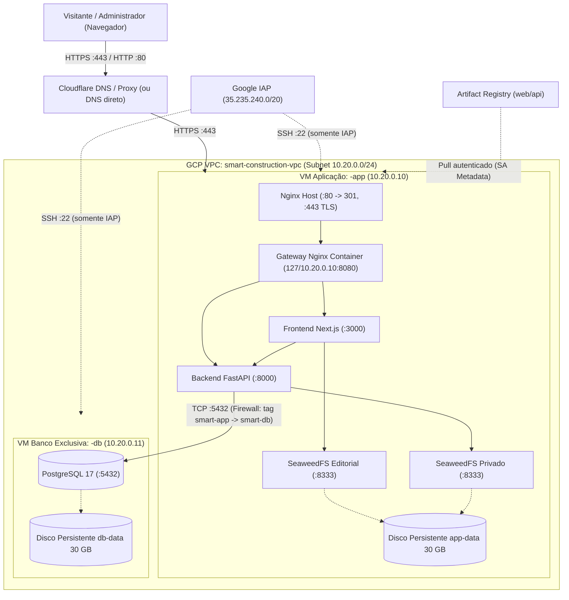

# Arquitetura de Nuvem, Segurança, Custos e Operação — Smart Construction

> Proposta técnica e operacional para implantação do **Smart Construction** (Bubikas Holdings) em nuvem, atendendo aos requisitos do **Escopo** e do **PM-04**.

---

## 1. Provedor escolhido e justificativa

**Provedor selecionado:** Google Cloud Platform (GCP), região `us-central1` (zona `us-central1-a`).

| Critério | Avaliação na GCP |
|---|---|
| **Requisitos técnicos** | Suporta VPC isolada, sub-redes privadas, regras de firewall por *network tags*, discos persistentes `pd-balanced`, Artifact Registry e túneis SSH via Identity-Aware Proxy (IAP) sem expor a porta 22 para a internet. |
| **Custos** | Créditos acadêmicos/tier inicial compatíveis com o laboratório; permite desligar VMs fora de uso e destruir toda a infraestrutura via Terraform mantendo apenas o bucket de state. |
| **Facilidade de operação** | CLI `gcloud`, backend remoto nativo no Cloud Storage (`gcs`) e autenticação de VM via Service Account/Metadata sem necessidade de chaves estáticas nas instâncias para baixar imagens. |
| **Limitações conhecidas** | Requer cota ativa no projeto (`compute.googleapis.com`, `artifactregistry.googleapis.com`, `iap.googleapis.com`) e cobrança contínua de discos/IP estático/bucket mesmo com VMs paradas, caso não sejam destruídos. |

### Alternativas avaliadas

- **AWS (EC2 + VPC + ECR + S3):** equivalente em recursos, porém exigiria configuração adicional de bastion host ou AWS SSM para evitar SSH público; na GCP o IAP já resolve o túnel SSH auditado sem custo adicional de bastion.
- **Azure (VMs + VNet + ACR):** igualmente compatível, mas a equipe já possui projeto GCP ativo (`projeto-mensal-515620`) e bucket de state configurado.

---

## 2. Topologia e distribuição em nuvem

### Justificativa da distribuição de componentes

- **VM Banco exclusiva (`<instance_name>-db`, `e2-medium`):** isola o PostgreSQL 17 dos serviços web/API. A regra `smart-construction-allow-db-from-app` em [terraform/main.tf](file:///c:/Users/burra/OneDrive/Documentos/GitHub/smart-construction-DedSec/terraform/main.tf) libera `TCP/5432` exclusivamente para instâncias com a tag `smart-app`. Não há regra pública de entrada na porta `5432`.
  - *Observação sobre `access_config {}` na VM DB:* a interface de rede recebe IP externo efêmero para baixar pacotes Ubuntu e a imagem `postgres:17-bookworm` sem exigir um Cloud NAT dedicado (reduzindo custo mensal). O firewall bloqueia qualquer entrada externa nessa interface, exceto túnel IAP na porta 22. Em produção corporativa, recomenda-se substituir por Cloud NAT e remover o IP externo da VM de banco.
- **VM Aplicação (`<instance_name>-app`, `e2-standard-2`):** concentra Nginx (host), Gateway interno, Next.js, FastAPI e os dois serviços SeaweedFS (`storage` e `private-storage`).
  - **SeaweedFS editorial e privado na VM App:** os buckets não possuem porta exposta para a internet; o bucket `smart-cadastros-private` aceita apenas requisições autenticadas da API na rede Docker interna do host.
  - **Nginx no host + Gateway em container:** o Nginx do sistema operacional termina o TLS na porta `443` (Cloudflare Origin Certificate ou Let's Encrypt), adiciona cabeçalhos de segurança (`X-Content-Type-Options`, `X-Frame-Options`, `Referrer-Policy`) e encaminha para o gateway interno (`10.20.0.10:8080`) com `X-Forwarded-Proto https`.

---

## 3. Segurança, segredos e etapas manuais justificadas

### Controles ativos
- **HTTPS e origem permitida:** [compose.app.yaml](file:///c:/Users/burra/OneDrive/Documentos/GitHub/smart-construction-DedSec/compose.app.yaml) fixa `SMART_API_ENVIRONMENT=production` (cookie administrativo `smart_admin_session` com atributo `Secure`) e `SMART_API_ALLOWED_ORIGINS=["${PUBLIC_ORIGIN}"]` (CORS/Origin estritos).
- **Segredos fora do repositório e dos logs:**
  - Credenciais de nuvem, chave SSH, domínio e certificado TLS ficam em **GitHub Secrets** (e são removidos do runner ao final do job com `if: always()`).
  - Credenciais de banco (`migration-password`, `api-password`) e SeaweedFS são geradas na VM App via `scripts/setup.sh` com `no_log: true` e nunca vão para o Git. Apenas as duas senhas do PostgreSQL são copiadas para a VM DB.
- **SSH sem porta pública aberta para `0.0.0.0/0`:** acesso administrativo apenas via Identity-Aware Proxy (`35.235.240.0/20`).

### Etapas manuais justificadas
1. **Criação inicial do bucket GCS de state:** pré-requisito único fora do Terraform para preservar o state remoto com versionamento (`gs://smart-bucket-projeto-mensal-515620`).
2. **Cadastro de DNS e emissão do certificado Origin (Cloudflare) ou apontamento DNS para Certbot:** depende do domínio da equipe.
3. **Configuração dos GitHub Secrets no repositório:** protege credenciais fora do código-fonte.
4. **Criação do usuário administrador e carga inicial das 25 profissões (`app.auth.cli` e `app.profissoes.cli`):** exigido pela política de segurança da aplicação para não embutir senhas padrão nem popular dados administrativos automaticamente.

---

## 4. Pipelines de CI/CD e parâmetros

1. **Validação contínua ([.github/workflows/ci.yaml](file:///c:/Users/burra/OneDrive/Documentos/GitHub/smart-construction-DedSec/.github/workflows/ci.yaml)):** executada em `push`/`pull_request` (lint, typecheck, unitários, build Next.js, Playwright E2E, Ruff, mypy, pytest e smoke em Docker Compose descartável).
2. **Provisionamento, atualização, backup e encerramento ([.github/workflows/deploy.yml](file:///c:/Users/burra/OneDrive/Documentos/GitHub/smart-construction-DedSec/.github/workflows/deploy.yml)):** acionada manualmente via `workflow_dispatch`:
   - `action`: `deploy` | `backup_and_restore_test` | `destroy`
   - `environment`: `dev` | `homolog` | `prod`
   - `instance_name`: prefixo das VMs
   - `app_machine_type` / `db_machine_type` / `data_disk_size_gb`: dimensionamento Terraform
   - `docker_tag` / `build_and_push_images`: versão explícita das imagens `web` e `api` (ou `sha`)
   - `update_os`, `update_app_images`, `update_db_image`, `extra_packages`, `tls_mode`
   - `confirm_destroy`: exige digitar `DESTROY` para executar `terraform destroy`.

---

## 5. Proposta técnica e estimativa mensal de custos (GCP `us-central1`)

> Valores de referência estimados em USD (base tabela pública GCP Compute Engine / Storage em `us-central1`, sujeitos a variação cambial e descontos de uso sustentado).

### Premissas de uso
- Operação contínua **730 h/mês** (cenário 24×7) e alternativa acadêmica **~240 h/mês** (desligando VMs fora de uso).
- Armazenamento: 2 discos de boot `20 GB` (`pd-balanced`) + 2 discos de dados `30 GB` (`pd-balanced`), totalizando `100 GB`.
- Tráfego de saída estimado: até `20 GB/mês` (catálogo e uploads sintéticos moderados).
- Imagens Docker no Artifact Registry: ~`2 GB` armazenados.

### Estimativa mensal discriminada (24×7)

| Recurso | Especificação | Quantidade | Custo estimado (USD/mês) |
|---|---|---|---|
| **VM Aplicação** | `e2-standard-2` (2 vCPU, 8 GB RAM) | 1 × 730 h | ~US\$ 48,91 |
| **VM Banco (PostgreSQL)** | `e2-medium` (2 vCPU compartilhadas, 4 GB RAM) | 1 × 730 h | ~US\$ 24,46 |
| **Discos persistentes** | `pd-balanced` (40 GB boot + 60 GB dados) | 100 GB | ~US\$ 10,00 |
| **IPs externos** | 1 IP estático (VM App em uso) + 1 IP efêmero (VM DB) | 2 × 730 h | ~US\$ 7,30 |
| **Artifact Registry** | Repositório Docker (`~2 GB`, 0,5 GB grátis) | 1,5 GB | ~US\$ 0,15 |
| **Bucket GCS (Terraform State)** | Standard regional (`< 1 GB`, versionado) | < 1 GB | ~US\$ 0,05 |
| **Egress / Rede** | Tráfego de saída internet (~20 GB, 1 GB grátis) | 19 GB | ~US\$ 2,28 |
| **Total mensal estimado (24×7)** | | | **~US\$ 93,15/mês** |

### Alternativas para redução de custo em laboratório
- **Desligar as VMs fora dos horários de teste/apresentação (~8 h/dia útil = ~176 h/mês):** reduz o custo de computação (`e2-standard-2` + `e2-medium`) de ~US\$ 73,37 para **~US\$ 17,70/mês**, levando o total mensal para cerca de **~US\$ 37,50/mês**.
- **Redimensionamento mínimo (dev):** usar `e2-medium` na App e `e2-small` no DB com discos de dados de `15 GB` (via parâmetros da pipeline) reduz ainda mais o consumo de créditos.

---

## 6. Backup, restauração isolada e encerramento

### Backup e restauração ([ansible/backup.yml](file:///c:/Users/burra/OneDrive/Documentos/GitHub/smart-construction-DedSec/ansible/backup.yml) e [ansible/restore-test.yml](file:///c:/Users/burra/OneDrive/Documentos/GitHub/smart-construction-DedSec/ansible/restore-test.yml))
- **Backup:** gera `database.dump` (`pg_dump -Fc` na VM DB) e compacta `editorial.tar`, `private.tar`, `secrets.tar`, `.env` e `release.txt` nos discos persistentes (`/srv/smart-construction-data/backups/<timestamp>`), gerando manifesto `SHA256SUMS`.
- **Restauração testada em ambiente isolado:** `restore-test.yml` valida os checksums `SHA256SUMS`, sobe um contêiner `postgres:17-bookworm` descartável isolado (sem sobrescrever o banco principal), restaura o `database.dump`, verifica contagem de tabelas/registros em `smart.cadastros` e `smart.profissoes`, extrai os arquivos de mídia em diretório temporário isolado e remove os recursos temporários ao concluir.

### Encerramento e custos residuais
- Executar a pipeline `.github/workflows/deploy.yml` com `action=destroy` e `confirm_destroy=DESTROY` remove VPC, subnet, firewalls, IPs, VMs, discos persistentes e Artifact Registry gerenciados pelo Terraform, e lista na saída se restou alguma instância, disco ou IP ativo.
- **O que permanece gerando cobrança (ou fora do Terraform):** apenas o **bucket GCS do state remoto** (`gs://smart-bucket-projeto-mensal-515620`, custo residual na casa de centavos por mês para manter o histórico de estado), a menos que o usuário o delete manualmente após concluir a disciplina.
