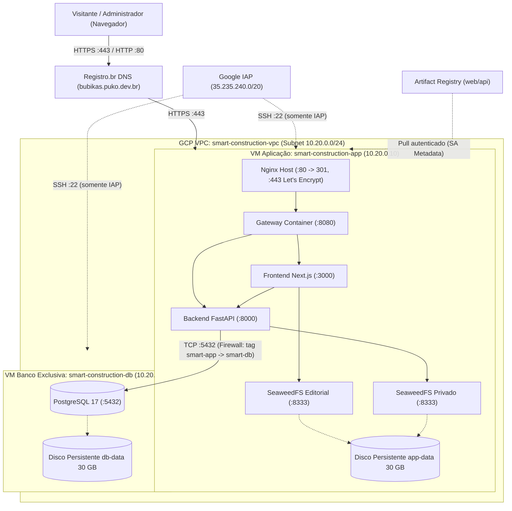
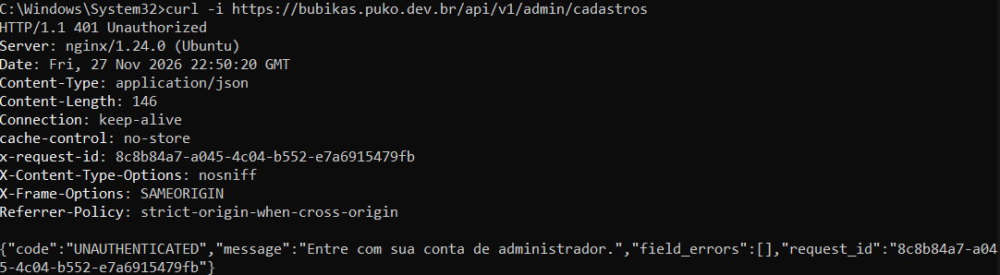

# Documentação Técnica e Evidências — PM-04 | Projeto Final

**Projeto:** Smart Construction (Bubikas Holdings)  
**Disciplina:** PM-04 — DevOps e Infraestrutura  
**Data de entrega:** 27/11/2026  
**Integrantes (até 3 nomes e RAs):** *(PREENCHER ANTES DE GERAR O PDF FINAL)*  
- Alexandro Augusto Ferreira Santos — RA: `506648`  
- Fábio Augusto Lorencini — RA: `506360` 
- Guillermo Del Toro Trillo — RA: `506474`  

**Repositório Git:** https://github.com/puko02/smart-construction-DedSec  
**Domínio HTTPS de validação:** `https://bubikas.puko.dev.br`

---

## 1. Análise da Demanda e Mapeamento de Requisitos

Com base no documento de demanda **Escopo da Bubikas Holdings** (`escopo.pdf` / [escopo.md](escopo.md)) e nos requisitos do **PM-04**, o sistema **Smart Construction** exige uma infraestrutura automatizada, segura e reproduzível para operar uma plataforma de serviços, catálogo de materiais e cadastro de profissionais/empresas da construção civil.

| Requisito da Demanda | Tradução para Infraestrutura / Automação | Arquivos Responsáveis |
|---|---|---|
| **Publicação em endereço HTTPS válido** | Nginx no host terminando TLS 1.2/1.3 na porta `443` (Let's Encrypt via Certbot ou Cloudflare Origin), redirecionando HTTP `80 → 301 HTTPS`, cabeçalhos de segurança e `SMART_API_ENVIRONMENT=production` (cookie `Secure`). | [ansible/site.yml](../ansible/site.yml), [ansible/templates/nginx-https.conf.j2](../ansible/templates/nginx-https.conf.j2), [compose.app.yaml](../compose.app.yaml) |
| **Aplicação Web + API modular** | Contêineres `web` (Next.js `:3000`), `api` (FastAPI `:8000`) e `gateway` (`:8080`) publicados no Artifact Registry e orquestrados via Docker Compose na VM de aplicação. | [Dockerfile](../Dockerfile), [backend/Dockerfile](../backend/Dockerfile), [compose.app.yaml](../compose.app.yaml) |
| **Banco PostgreSQL 17 isolado da internet** | VM exclusiva (`smart-construction-db`, IP privado `10.20.0.11`) com firewall liberando `TCP/5432` **apenas** para a tag `smart-app`. Sem regra de entrada pública na porta `5432`. | [terraform/main.tf](../terraform/main.tf), [compose.db.yaml](../compose.db.yaml) |
| **Armazenamento persistente de mídias e banco** | Dois discos persistentes `pd-balanced` (`30 GB` cada: `smart-construction-app-data` e `smart-construction-db-data`) montados em `/srv/smart-construction-data`, hospedando volumes do PostgreSQL, Docker e SeaweedFS (`storage` e `private-storage`). | [terraform/main.tf](../terraform/main.tf), [ansible/site.yml](../ansible/site.yml) |
| **Segurança de segredos e acesso administrativo** | Credenciais de nuvem/SSH/domínio em GitHub Secrets e autenticação GCP via Workload Identity Federation (sem chave JSON estática). Acesso SSH exclusivo via Google IAP (`35.235.240.0/20`). Senhas do banco geradas na VM sem log (`no_log: true`). | [.github/workflows/deploy.yml](../.github/workflows/deploy.yml), [ansible/site.yml](../ansible/site.yml) |
| **Administração e carga inicial controladas** | Conta administrativa criada via CLI (`app.auth.cli`) e carga das 25 profissões via CLI (`app.profissoes.cli --apply`), garantindo ausência de senhas padrão no código. | [README.md](../README.md) |
| **Backup e restauração verificada** | Playbooks dedicados para gerar snapshot (`pg_dump -Fc`, volumes SeaweedFS, `.env`, `.secrets` e manifesto `SHA256SUMS`) e validar restauração em contêiner PostgreSQL isolado. | [ansible/backup.yml](../ansible/backup.yml), [ansible/restore-test.yml](../ansible/restore-test.yml) |

---

## 2. Decisões de Arquitetura, Provedor de Nuvem e Custos

### 2.1 Provedor escolhido: Google Cloud Platform (GCP)
- **Região / Zona:** `us-central1` / `us-central1-a`.
- **Justificativa:**
  1. **Segurança sem bastion pago:** o **Identity-Aware Proxy (IAP)** permite acesso SSH auditado às VMs usando apenas o intervalo `35.235.240.0/20`, eliminando abertura da porta `22` para `0.0.0.0/0` e dispensando uma terceira VM bastion.
  2. **Integração nativa de imagens e state:** o **Artifact Registry** autentica a VM de aplicação via Service Account/Metadata, e o **Cloud Storage (GCS)** hospeda o state remoto do Terraform com versionamento (`gs://smart-bucket-projeto-mensal-515620`).
  3. **Comparativo:** AWS (EC2 + ECR + S3) e Azure (VMs + ACR) atenderiam de forma equivalente, porém a equipe já dispunha do projeto GCP `projeto-mensal-515620` ativo e compatível com os créditos acadêmicos.

### 2.2 Topologia da solução



Para detalhes completos de segurança e dimensionamento, consulte [ARQUITETURA_NUVEM.md](ARQUITETURA_NUVEM.md).

### 2.3 Estimativa mensal de custos (GCP `us-central1`)

| Recurso | Especificação | Quantidade | Custo estimado (USD/mês · 24×7) |
|---|---|---|---|
| **VM Aplicação** | `e2-standard-2` (2 vCPU, 8 GB RAM) | 1 × 730 h | ~US\$ 48,91 |
| **VM Banco (PostgreSQL)** | `e2-medium` (2 vCPU compartilhadas, 4 GB RAM) | 1 × 730 h | ~US\$ 24,46 |
| **Discos persistentes** | `pd-balanced` (40 GB boot + 60 GB dados) | 100 GB | ~US\$ 10,00 |
| **IPs externos** | 1 IP estático (App) + 1 IP efêmero (DB) | 2 × 730 h | ~US\$ 7,30 |
| **Artifact Registry** | Repositório Docker (`~2 GB`, 0,5 GB grátis) | 1,5 GB | ~US\$ 0,15 |
| **Bucket GCS (Terraform State)** | Standard regional (`< 1 GB`, versionado) | < 1 GB | ~US\$ 0,05 |
| **Egress / Rede** | Tráfego de saída (~20 GB, 1 GB grátis) | 19 GB | ~US\$ 2,28 |
| **Total mensal estimado (24×7)** | | | **~US\$ 93,15/mês** |
| **Uso acadêmico (~176 h/mês)** | Desligando VMs fora de testes/apresentação | | **~US\$ 37,50/mês** |

---

## 3. Pipeline CI/CD, Terraform e Ansible

### 3.1 Parâmetros dinâmicos da pipeline ([.github/workflows/deploy.yml](../.github/workflows/deploy.yml))
A pipeline é acionada manualmente via `workflow_dispatch` e executa em sequência: **1. Terraform Provision / Update → 2. Build & Push Images → 3. Ansible Configure & Deploy → 4. Verify HTTPS & Network Isolation** (além das ações `backup_and_restore_test` e `destroy`):

- `action`: `deploy` | `backup_and_restore_test` | `destroy`
- `environment`: `dev` | `homolog` | `prod`
- `instance_name`: prefixo das VMs e recursos (ex.: `smart-construction`)
- `app_machine_type` / `db_machine_type` / `data_disk_size_gb`: dimensionamento via Terraform
- `docker_tag` / `build_and_push_images`: versão explícita das imagens `web` e `api` (ou `sha`)
- `update_os` / `update_app_images` / `update_db_image` / `extra_packages` / `tls_mode`: controle de manutenção e TLS via Ansible
- `confirm_destroy`: confirmação explícita (`DESTROY`) para encerramento seguro

### 3.2 Provisionamento com Terraform ([terraform/](../terraform))
- Backend remoto GCS configurado em [terraform/backend.tf](../terraform/backend.tf).
- Criação parametrizada de APIs (`compute`, `artifactregistry`, `iap`), VPC (`smart-construction-vpc`), subnet (`10.20.0.0/24`), 3 regras de firewall (`allow-public-http-https`, `allow-iap-ssh`, `allow-db-from-app`), 3 endereços IP (`app_public`, `app_private`, `db_private`), 2 discos persistentes (`app_data`, `db_data`), Service Account dedicada da VM, repositório Artifact Registry e 2 instâncias Compute Engine (`smart-construction-app` e `smart-construction-db`).

### 3.3 Configuração e manutenção com Ansible ([ansible/](../ansible))
- Inventário dinâmico gerado a partir dos outputs do Terraform e acesso SSH via túnel IAP (`gcloud compute start-iap-tunnel`).
- [ansible/site.yml](../ansible/site.yml): valida Ubuntu, aplica atualização de SO quando `update_operating_system=true`, instala pacotes extras (`extra_packages`) e Docker/Compose, formata/monta os discos persistentes em `/srv/smart-construction-data` preservando dados existentes, configura `docker` para depender do ponto de montagem, gera `.env` e credenciais sem log, configura Nginx HTTPS (com Let's Encrypt e renovação via `certbot.timer`) e sobe `compose.db.yaml` e `compose.app.yaml`.

---

## 4. Evidências de Execução na Nuvem

### 4.1 Cenário 1 — Criação inicial pela pipeline
O provisionamento inicial via Terraform criou **20 recursos** na GCP (`Apply complete! Resources: 20 added, 0 changed, 0 destroyed.`), incluindo VPC, subnet, firewalls, discos persistentes, Artifact Registry, IPs e as duas VMs (`smart-construction-app` em `10.20.0.10` / IP público `35.193.135.222` e `smart-construction-db` em `10.20.0.11`).

- **Log completo de criação (Terraform Apply):** [DedSec/terraform apply.txt](../DedSec/terraform%20apply.txt)

```text
Apply complete! Resources: 20 added, 0 changed, 0 destroyed.

Outputs:
app_private_ip = "10.20.0.10"
app_public_ip = "35.193.135.222"
app_server_name = "smart-construction-app"
artifact_registry_repository = "us-central1-docker.pkg.dev/***/smart-construction"
db_private_ip = "10.20.0.11"
db_server_name = "smart-construction-db"
environment = "prod"
```

Execução completa da pipeline (`Infrastructure Deploy & Lifecycle #7`) com todos os 4 jobs concluídos com sucesso (`1 · Terraform Provision / Update`, `2 · Build & Push Images`, `3 · Ansible Configure & Deploy`, `4 · Verify HTTPS & Network Isolation`):


> *(Observação: o arquivo `DedSec/build.pdf` encontra-se vazio — 0 bytes — e deve ser substituído/capturado caso seja necessário anexar o log detalhado do job `2 · Build & Push Images`.)*

---

### 4.2 Cenário 2 — Atualização parametrizada pela pipeline
*(Pendente de captura na pasta `DedSec/`: anexar print/log de execução alterando ao menos 1 parâmetro Terraform, como `app_machine_type` ou `data_disk_size_gb`, e 1 parâmetro Ansible, como `extra_packages=curl,git,unzip` ou `update_os=true`, comprovando atualização sem recriação dos discos.)*

---

### 4.3 Cenário 3 — Reexecução sem alterações (Idempotência)
Na reexecução da pipeline com os mesmos parâmetros, o Terraform reportou `Apply complete! Resources: 0 added, 0 changed, 0 destroyed.`, comprovando que o state remoto preserva a infraestrutura sem recriações indevidas:


---

### 4.4 Validação da Demanda, Segurança e Critérios de Aceite

1. **Acesso público via HTTPS com certificado válido (Let's Encrypt) em `https://bubikas.puko.dev.br`:**


2. **Isolamento de rede — porta `5432` fechada na internet e verificação HTTPS no Job 4:**


3. **Proteção das rotas administrativas sem autenticação (`401 Unauthorized` em `/api/v1/admin/cadastros`):**



4. **Carga das 25 profissões oficiais (`app.profissoes.cli --apply`), cadastro sintético de profissional com foto (`Cara Resenhudo`), cadastro sintético de empresa privada (`RESENHAX`) e aprovação administrativa:**
   - **25 profissões ativas no painel `/admin/profissoes`:** [DedSec/profissoes.pdf](../DedSec/profissoes.pdf)
   - **Cadastro de profissional sintético com foto de perfil (`87 KB`) em `/admin/cadastros`:** [DedSec/cadastro.pdf](../DedSec/cadastro.pdf)
   - **Cadastro de empresa sintética aprovada e mantida privada (`RESENHAX`, CNPJ `12345678000195`):** [DedSec/cadastro empresa.pdf](../DedSec/cadastro%20empresa.pdf)

---

### 4.5 Backup, Restauração Isolada e Encerramento (`destroy`)

- **Backup e Restore Isolado (`action=backup_and_restore_test`):**  
  *(Observação: o arquivo `DedSec/print backup.pdf` encontra-se vazio — 0 bytes — e precisa ser reexportado do GitHub Actions caso seja exigida a evidência visual do job `Backup & Isolated Restore Test`.)*

- **Encerramento completo da infraestrutura (`action=destroy`, `confirm_destroy=DESTROY`):**  
  O log completo em [DedSec/destroy.pdf](../DedSec/destroy.pdf) comprova `Destroy complete! Resources: 20 destroyed.` e a verificação pós-destroy retornando **`Listed 0 items`** para instâncias GCE, discos persistentes e endereços IP externos, restando exclusivamente o bucket GCS do state remoto (`TF_STATE_BUCKET`).

---

## 5. Checklist de Conformidade Final

| Critério PM-04 / Escopo | Status | Evidência em `DedSec/` |
|---|---|---|
| Pipeline CI/CD parametrizada no GitHub Actions | Concluído | [print CI-CD deploy.png](../DedSec/print%20CI-CD%20deploy.png) |
| Cenário 1 — Provisionamento inicial (20 recursos GCP) | Concluído | [terraform apply.txt](../DedSec/terraform%20apply.txt) |
| Cenário 2 — Atualização parametrizada (Terraform + Ansible) | Pendente | *(Capturar print/log se exigido)* |
| Cenário 3 — Idempotência (`0 added, 0 changed, 0 destroyed`) | Concluído | [print CI-CD.png](../DedSec/print%20CI-CD.png) |
| Site HTTPS com domínio próprio e certificado Let's Encrypt | Concluído | [site com DNS HTTPS.png](../DedSec/site%20com%20DNS%20HTTPS.png) |
| Porta `5432` fechada na internet | Concluído | [5432 port.png](../DedSec/5432%20port.png) |
| Rota administrativa protegida (`401 Unauthorized`) | Concluído | [401.png](../DedSec/401.png) |
| 25 profissões + profissional com foto + empresa privada aprovada | Concluído | [profissoes.pdf](../DedSec/profissoes.pdf), [cadastro.pdf](../DedSec/cadastro.pdf), [cadastro empresa.pdf](../DedSec/cadastro%20empresa.pdf) |
| Backup & Restore isolado (`backup_and_restore_test`) | Arquivo vazio | `print backup.pdf` (0 bytes — reexportar) |
| Destroy limpo (`20 destroyed`, `0 items` ativos) | Concluído | [destroy.pdf](../DedSec/destroy.pdf) |
